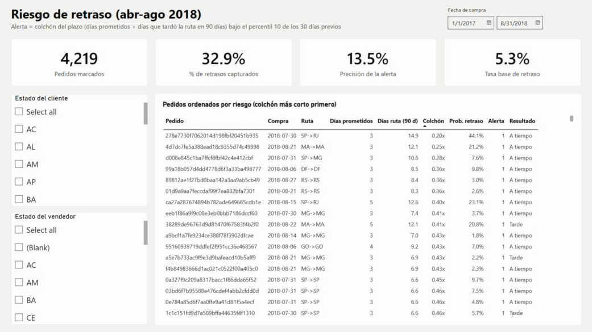

# Late Delivery Risk at Olist: SQL, Machine Learning and Power BI

**Can we tell, at the moment of purchase, which orders will arrive late, so the company can adjust the promised date or prioritize shipping before customers leave a bad review?**

## Key results

- **Late deliveries drive bad reviews.**
  - Late orders average **2.3 stars vs. 4.3** for on-time orders.
  - **62%** of their reviews are negative (1–2 stars), vs. **9%** for on-time orders.
  - Delays account for about **4,000 extra negative reviews, 31% of all negative reviews**.
- **The strongest predictor is how much buffer the promise leaves.** The *promise ratio* divides the promised delivery days by the route's average delivery time over the last 90 days.
  - With the shortest buffer (bottom 10%), **19%** of orders arrive late.
  - With the widest buffer (top 10%), fewer than **4%** do.
- **A one-line rule beats the machine learning models.**
  - Flagging the 10% of orders with the shortest buffer catches **29.4% of all late orders** (95% CI 27.4–31.3%), about **3× better than random**, in an out-of-time test (Apr–Aug 2018).
  - Logistic regression and gradient boosting, trained on 26 features, both scored **~3.5 points lower**, and the gap is statistically significant.
  - A monthly backtest confirms the result: gradient boosting degraded to below random in the last month, while the rule never fell below 16.7%.

## Recommendation

1. **Enforce a minimum delivery buffer.** Never promise less than **1.3×** the route's recent delivery time.
   - In the test period this would have changed the promised date for 22% of orders, by +3.6 days on average.
   - It would have turned **23% of late orders into on-time orders** (398 orders in five months).
   - Run it as an **A/B test**: a longer promise can lower conversion, and this dataset cannot measure that.
2. **Daily risk alert for the logistics team.** Flag orders whose promise ratio falls below the 10th percentile of the last 30 days.
   - In the test period it flagged 13% of orders and caught **33% of late deliveries**, with a hit rate 2.5× the base rate.
   - No retraining needed: the threshold updates itself.

## Dashboard


Three pages in Power BI:

- **Executive:** revenue, orders, on-time %, rating.
- **Logistics:** late deliveries by state, promised vs. actual days, sellers.
- **Risk:** test-period orders ranked by risk.

| Logistics | Risk |
|---|---|
|  |  |

The data model, every DAX measure and the report definition (PBIR) are in [`powerbi/`](powerbi/).

## How it was built

| Stage | Tools | What it does |
|---|---|---|
| 1. Data model | PostgreSQL 16 | Loads 9 raw tables into a **dimensional model**: two fact tables at different grains (`fact_orders` per order, `fact_order_items` per item) that share customer, seller, product and date dimensions. Analysis queries use CTEs and window functions (`LAG`, `RANK`, running totals, Pareto shares). |
| 2. Exploration | pandas, matplotlib | Target balance, time trends, review impact, data quality. |
| 3. Features | pandas | Leakage-safe history features: a seller's or route's past outcome is used only once it was **known** at purchase time. Verified by brute force. |
| 4. Model | scikit-learn | Rule vs. logistic regression vs. gradient boosting. Selection on a validation period, out-of-time test, bootstrap CIs, monthly walk-forward backtest, permutation importance. |
| 5. Dashboard | Power BI (DAX) | Constellation model: two fact tables (orders and risk scores) sharing conformed dimensions, with single-direction one-to-many relationships. 26 measures in display folders, each validated against SQL. |

### Methodology highlights

- **Target.** An order is *not on time* if it was delivered after the promised date. Orders that were shipped but never delivered are counted as not on time: all of them had passed their promised date at the data cutoff. Excluding them would hide exactly the cases that matter.
- **No look-ahead.** History features only use orders whose outcome was already known: an on-time order at its delivery date, a late order at the end of its promised day.
- **No hidden period effects.** Smoothing priors are computed with data from before each evaluation period only. Training sets include only orders resolved before that period starts.
- **Drift-aware feature choices.** The business changed a lot in 2018: promised days fell from ~24 to ~16 and deliveries got faster. Features that let a model memorize the training era were removed (purchase month, absolute order volumes). The route history uses a 90-day window chosen on the validation period.
- **A business-driven metric.** The main metric is the share of late orders caught when the team reviews a fixed 10% of orders. AUC-PR is reported because classes are imbalanced (7.8% late); AUC-ROC is included for reference.

## Repository structure

```
├── sql/
│   ├── 01_create_raw_tables.sql    # raw schema (9 tables)
│   ├── 02_load_raw.sql             # COPY the CSVs
│   ├── 03_star_schema.sql          # analytics schema: dimensions + facts + integrity checks
│   ├── 04_analysis.sql             # business questions (CTEs, window functions)
│   └── 05_export_model_base.sql    # exports for Python and Power BI
├── notebooks/
│   ├── 01_eda.ipynb
│   ├── 02_features.ipynb
│   └── 03_model.ipynb
├── src/
│   ├── features.py                 # leakage-safe feature engineering
│   ├── export_powerbi.py           # builds the Power BI tables
│   └── plot_style.py
├── powerbi/                        # data model, DAX measures, page layout, validation
├── reports/
│   ├── reporte_tecnico.pdf         # technical report (Spanish)
│   ├── model_metrics.json          # experiment config and metrics
│   ├── figures/
│   └── sql_results/                # outputs of 04_analysis.sql
├── data/                           # raw data is not versioned; see data/README.md
└── assets/
```

## Reproduce

Requirements: PostgreSQL 16+ and Python 3.11+.

```bash
pip install -r requirements.txt

# 1. Data (see data/README.md)
git clone --depth 1 https://github.com/olist/work-at-olist-data.git /tmp/olist
cp /tmp/olist/datasets/*.csv data/raw/

# 2. Database
createdb olist
psql -d olist -f sql/01_create_raw_tables.sql
psql -d olist -v data_dir="$PWD/data/raw" -f sql/02_load_raw.sql
psql -d olist -f sql/03_star_schema.sql
psql -d olist -v out_dir="$PWD/reports/sql_results" -f sql/04_analysis.sql
psql -d olist -v out_dir="$PWD/data/processed" -f sql/05_export_model_base.sql

# 3. Notebooks (in order), then the Power BI tables
jupyter nbconvert --to notebook --execute --inplace notebooks/0*.ipynb
python src/export_powerbi.py
```

The model notebook runs in about 3 minutes on a laptop. All random seeds are fixed.

## Limitations

- **Conversion is not observed.** The dataset only includes completed purchases, so the cost of a longer promise in lost sales cannot be measured. That is why the recommendation is an A/B test.
- **The data ends in August 2018.** The patterns are those of Olist's marketplace in 2017–2018.
- **Review attribution is correlational.** "Extra" negative reviews compare late orders against the on-time negative rate; other factors may differ between the two groups.

## Data

[Brazilian E-Commerce Public Dataset by Olist](https://www.kaggle.com/datasets/olistbr/brazilian-ecommerce): about 100k orders from 2016 to 2018, released by Olist.

## Author

**Carlos Daniel Torres Pillado**: data analyst with a background in applied statistics.
[cdtorres.pi@gmail.com](mailto:cdtorres.pi@gmail.com)
