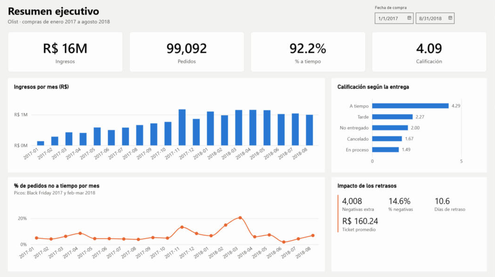
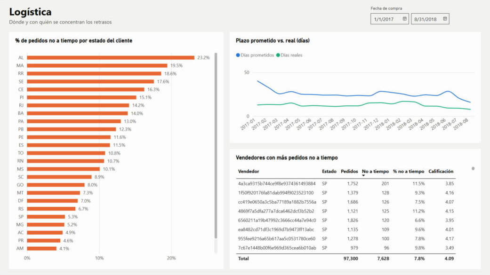

# Late Delivery Risk at Olist: SQL, Machine Learning and Power BI

On an online marketplace, an order that arrives late almost always ends in a bad review, and bad reviews weigh on the future sales of both the seller and the platform. The damage happens after the purchase, but the chance to prevent it comes before: at the moment of purchase there is still time to promise a more realistic date or to prioritize the shipment.

Using 100k real orders from Olist, a Brazilian marketplace, I set out to answer whether it is possible to tell at purchase time which orders will arrive late, and how much that is worth. I used PostgreSQL for the data model, Python for the analysis and the model, and Power BI for the dashboard.

## What I found

### Delays explain a large share of bad reviews

The first step was confirming that the problem mattered. Late orders average 2.3 stars versus 4.3 for orders that arrive on time, and 62% of their reviews are negative (1 or 2 stars), against 9% for on-time orders. In total, delays account for about 4,000 extra negative reviews, 31% of all negative reviews in the period.

### The risk lies in the promise, not just the shipping

The strongest signal was not in the product or the seller, but in how tight the promised date was. In the model's permutation importance, that variable weighs almost three times as much as the next one. I measure it as a ratio: promised days divided by how long the same route (seller's state to customer's state) took over the last 90 days. Among orders with the tightest ratio, 19% arrive late; among those with the most slack, fewer than 4% do.

### A simple rule beat the models

I expected a machine learning model with more information to beat that ratio, so I trained a logistic regression and a gradient boosting model on 26 features. It did not. Flagging the 10% of orders with the tightest ratio catches 29.4% of all late orders (95% CI: 27.4–31.3%), about three times what random selection would catch. Both models caught about 3.5 percentage points fewer, and the gap is statistically significant. I evaluated this on April–August 2018, a period no model saw during development.

The month-by-month backtest explained why. Olist's delivery times changed quickly in 2018 and the models aged badly: gradient boosting fell below random in August 2018. The ratio, by contrast, is recomputed from each route's last 90 days, adapts on its own and never dropped below 16.7%. For this problem, the simplest solution was also the most stable.

## What I would recommend

1. Set a minimum buffer on the promised date: never promise less than 1.3 times the route's recent delivery time. Over the test period, this would have pushed back the date for 22% of orders, by 3.6 days on average, and 398 late orders (23%) would have arrived on time. A longer promise can cost sales, and this data only covers completed purchases, so I would launch it first as an A/B test.
2. Give the logistics team a daily alert with the orders whose ratio falls below the 10th percentile of the last 30 days. Over the test period, the alert flagged 13% of orders and caught 33% of late deliveries; 13.5% of flagged orders arrived late, 2.5 times the base rate. The threshold adjusts itself, so nothing needs retraining.

## Dashboard



The Power BI report has three pages: an executive summary (revenue, orders, on-time rate and rating), a logistics view (late deliveries by state, promised versus actual days and the sellers with the most delays) and a risk view that ranks test-period orders from the tightest buffer to the loosest.

| Logistics | Risk |
|---|---|
|  |  |

The data model, the DAX measures and the report definition are in [`powerbi/`](powerbi/).

## How I built it

| Stage | Tools | What it does |
|---|---|---|
| Data model | PostgreSQL 16 | Loads the 9 source tables into a dimensional model with two fact tables at different grains (`fact_orders` per order and `fact_order_items` per item) and shared customer, seller, product and date dimensions. The analysis queries use CTEs and window functions (`LAG`, `RANK`, running totals and Pareto shares). |
| Exploration | pandas, matplotlib | Target balance, trends over time, effect on reviews and data quality. |
| Features | pandas | Seller and route history using only information available at purchase time. |
| Model | scikit-learn | The ratio rule versus logistic regression and gradient boosting, chosen on a validation period and tested out of time, with bootstrap intervals, a monthly backtest and permutation importance. |
| Dashboard | Power BI, DAX | Two fact tables (all orders and the test-period risk scores) sharing the same dimensions, with one-to-many, single-direction relationships. 26 measures, each checked against SQL. |

### Design decisions

- What counts as late: an order is late if it was delivered after the promised day. I also count the 1,097 orders that were shipped but never delivered, because all of them were already past their promised date when the data ends; leaving them out would hide the worst cases.
- No information from the future: a seller's or route's history only includes orders whose outcome was already known at purchase time. An on-time order counts once it is delivered; a late one, once its promised day has passed. I checked the efficient implementation against a brute-force version on 500 random orders and they matched exactly.
- I dropped features that age badly: the purchase month and absolute order volumes let the models memorize the training period. The 90-day window for route history was chosen on the validation period.
- A metric the business can use: the main metric is the share of late orders caught when the team can only review 10% of orders. With 7.8% late orders, accuracy would be misleading, so I also report AUC-PR, with AUC-ROC for reference.

## Repository structure

```
├── sql/
│   ├── 01_create_raw_tables.sql    # raw schema (9 tables)
│   ├── 02_load_raw.sql             # loads the CSV files
│   ├── 03_star_schema.sql          # analytics schema: dimensions, facts and integrity checks
│   ├── 04_analysis.sql             # business questions (CTEs, window functions)
│   └── 05_export_model_base.sql    # exports for Python and Power BI
├── notebooks/
│   ├── 01_eda.ipynb
│   ├── 02_features.ipynb
│   └── 03_model.ipynb
├── src/
│   ├── features.py                 # feature engineering
│   ├── export_powerbi.py           # builds the Power BI tables
│   └── plot_style.py
├── powerbi/                        # data model, DAX measures, report pages and validation
├── reports/
│   ├── model_metrics.json          # experiment settings and results
│   ├── figures/
│   └── sql_results/                # outputs of 04_analysis.sql
├── data/                           # raw data is not versioned; see data/README.md
└── assets/
```

## How to reproduce it

You need PostgreSQL 16+ and Python 3.11+.

```bash
pip install -r requirements.txt

# 1. Data (see data/README.md)
git clone --depth 1 https://github.com/olist/work-at-olist-data.git /tmp/olist
cp /tmp/olist/datasets/*.csv data/raw/

# 2. Database
createdb olist
psql -d olist -f sql/01_create_raw_tables.sql
psql -d olist -v data_dir="$PWD/data/raw" -f sql/02_load_raw.sql
psql -d olist -f sql/03_star_schema.sql
psql -d olist -v out_dir="$PWD/reports/sql_results" -f sql/04_analysis.sql
psql -d olist -v out_dir="$PWD/data/processed" -f sql/05_export_model_base.sql

# 3. Notebooks in order, then the Power BI tables
jupyter nbconvert --to notebook --execute --inplace notebooks/0*.ipynb
python src/export_powerbi.py
```

The model notebook takes about 3 minutes on a laptop. All random seeds are fixed.

## Limitations

- The data only covers completed purchases, so I cannot measure how many sales a longer promised date would cost. That is why the recommendation is an A/B test.
- The data ends in August 2018 and reflects Olist's marketplace at that time.
- The link between delays and negative reviews is correlational: late and on-time orders may also differ in other ways.

## Data

[Brazilian E-Commerce Public Dataset by Olist](https://www.kaggle.com/datasets/olistbr/brazilian-ecommerce), about 100k orders from 2016 to 2018, published by Olist.

## Author

Carlos Daniel Torres Pillado, data analyst with a background in applied statistics. Chihuahua, Mexico.

- GitHub: [@cdtorrespi](https://github.com/cdtorrespi)
- Email: [cdtorres.pi@gmail.com](mailto:cdtorres.pi@gmail.com)
